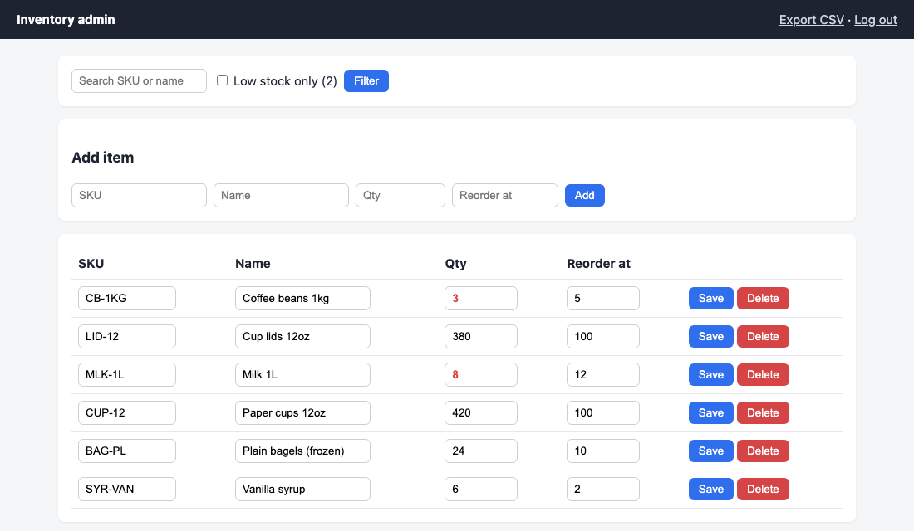

# Admin web tool sample (FastAPI) · 관리자 웹 도구 샘플

Small inventory admin: password login, search, add / edit / delete, low-stock filter, CSV export (Excel-friendly UTF-8 BOM). SQLite storage, no JavaScript framework.



```bash
pip install -r requirements.txt
ADMIN_PASSWORD=change-me uvicorn app:app      # http://127.0.0.1:8000
pytest -q                                      # login, CRUD, duplicate SKU, low-stock filter, CSV
```

한국어: 재고·예약·회원 같은 표 데이터를 브라우저에서 관리하는 작은 관리자 도구입니다. 로그인, 검색, 추가·수정·삭제, 부족 재고 필터, 엑셀용 CSV 내보내기가 들어 있고 테스트로 확인했습니다. 실제 주문은 고객 업무에 맞춰 항목·권한·배포(고객 서버 또는 클라우드)를 정합니다.

---
**About / 안내** — Sample by **MANI** (Korea). Built with AI-assisted development (Claude Code) and run/tested before publishing. Custom work available on Kmong and Fiverr.
MANI 샘플입니다. AI 보조 개발(Claude Code)로 만들고 공개 전에 직접 실행·테스트했습니다. 맞춤 작업은 크몽·Fiverr에서 주문할 수 있습니다.
